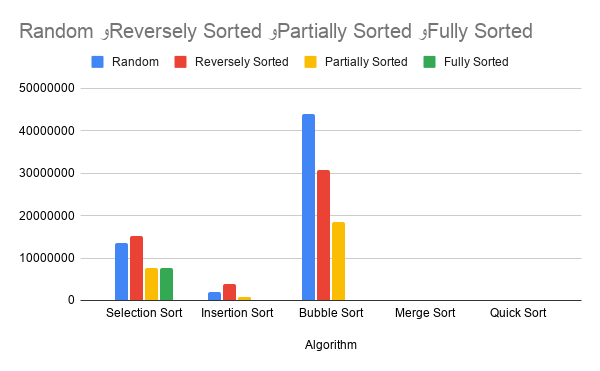

# Sorting Algorithms Benchmark

## 1. البيانات الشخصية
* الاسم: تقوى ابوالقاسم علي صميدة
* الرقم الجامعي: 3168268
* رقم الشعبة: المجموعة  c
## 2. جدول نتائج الأزمنة بالميكروثانية (μs)

| Algorithm | Random (μs) | Reversely Sorted (μs) | Partially Sorted (μs) | Fully Sorted (μs) |
| :--- | :---: | :---: | :---: | :---: |
| Selection Sort | 13,616,174 | 15,089,801 | 7,606,401 | 7,641,996 |
| Insertion Sort | 1,903,805 | 3,938,238 | 830,005 | 547 |
| Bubble Sort | 43,971,878 | 30,646,173 | 18,662,656 | 136 |
| Merge Sort | 35,659 | 15,562 | 22,043 | 15,987 |
| Quick Sort | 21,481 | 5,270 | 9,249 | 3,534 |

## 3. الرسم البياني (Chart)

## 4. تحليل ومناقشة النتائج

### الفرق في الأداء بين خوارزميات O(N^2) وخوارزميات O(N log N)
لما قارنت النتائج بين خوارزميات O(N^2) (وهي Selection Sort وInsertion Sort وBubble Sort) وبين خوارزميات O(N log N) (وهي Merge Sort وQuick Sort)، طلع الفرق واضح جداً لصالح O(N log N) خصوصاً في البيانات العشوائية والعكسية وشبه المرتبة. مثلاً في حالة Random أخذت Quick Sort حوالي 21,481 μs وMerge Sort حوالي 35,659 μs، بينما وصلت Bubble Sort إلى 43,971,878 μs وSelection Sort إلى 13,616,174 μs، والسبب أن عدد المقارنات والعمليات في الخوارزميات التربيعية يزيد بشكل كبير مع كبر حجم المصفوفة.

### تحديد الخوارزمية الأفضل في الحالة المرتبة والمرتبة جزئياً مع التعليل
* في الحالة المرتبة (Fully Sorted): سجلت Bubble Sort أقل زمن (136 μs) وتلتها Insertion Sort (547 μs) لأن المصفوفة مرتبة أصلاً فما فيش تبديل أو إزاحة كبيرة للعناصر (Insertion Sort تتصرف هنا قريب من الزمن الخطي)، بينما ظلت Selection Sort بطيئة نسبياً (7,641,996 μs) لأنها تستمر في مقارنة العناصر لإيجاد الأصغر في كل دورة. أما Quick Sort (3,534 μs) وMerge Sort (15,987 μs) فكان أداؤهما ممتازاً أيضاً.
* في الحالة المرتبة جزئياً (Partially Sorted): من خوارزميات O(N^2) كانت Insertion Sort هي الأفضل (830,005 μs) لأن أغلب العناصر قريبة من مكانها الصحيح فتقل الإزاحات، بينما بقيت Quick Sort (9,249 μs) وMerge Sort (22,043 μs) الأسرع بشكل عام لأنها تقسم المصفوفة إلى أجزاء أصغر.

### تفسير سلوك Quick Sort في الحالة العكسية/الكاملة وتأثير عنصر المحور (Pivot)
في البداية واجهت مشكلة StackOverflowError مع Quick Sort، وبعدها عدّلت اختيار عنصر المحور (Pivot) في دالة partition ليكون عنصر المنتصف (midIndex = left + (right - left) / 2) بدل الاعتماد على طرف المصفوفة فقط. هذا التعديل خفّف من الانقسام غير المتوازن ومنع التعمق الزائد في الاستدعاءات، فظهرت نتائج Quick Sort مستقرة وسريعة حتى في الحالة العكسية (5,270 μs) والمرتبة بالكامل (3,534 μs).
